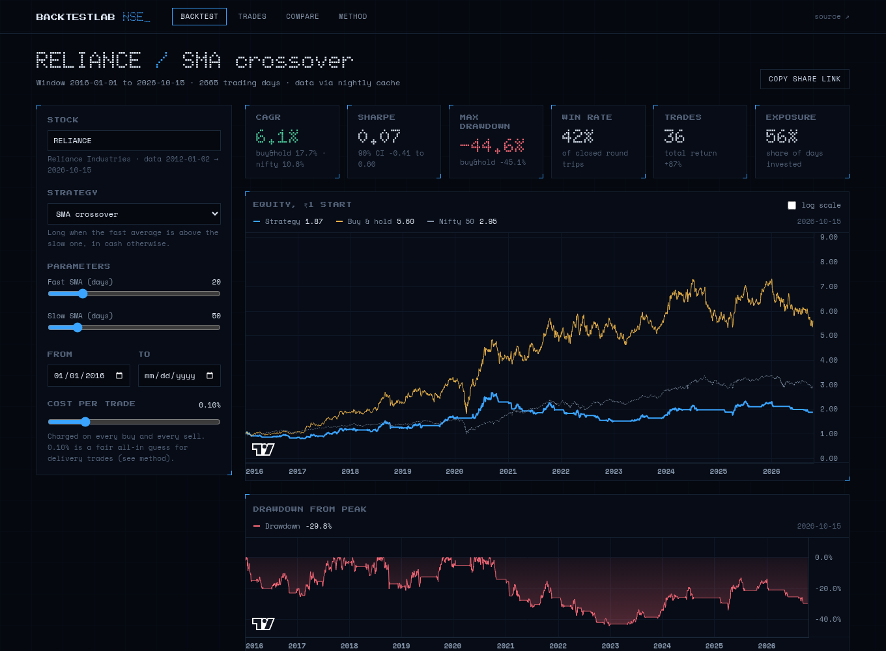
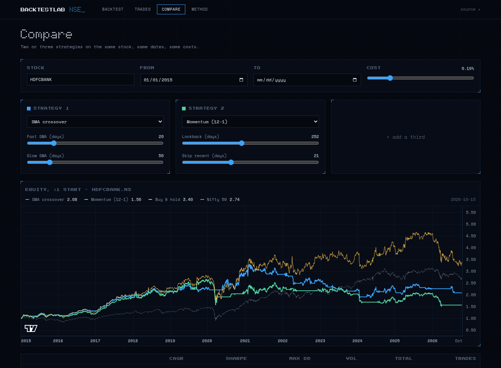
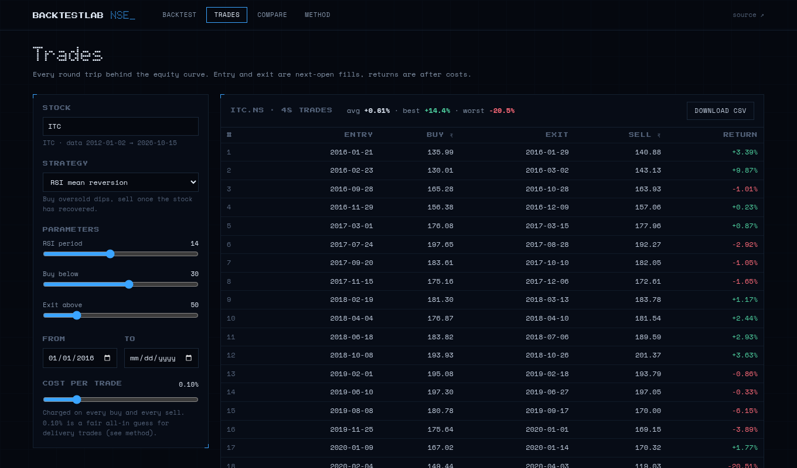

# BacktestLab NSE

Pick an NSE stock, pick a rule, pick dates. See what it would have done, costs included, next to buy-and-hold and the Nifty.

It is built to be hard to fool yourself with: signals use only past data, trades fill at the next open, every trade pays a cost, and the Sharpe ratio comes with a bootstrap interval so you can see how much of it is noise. Most simple strategies do not beat buy-and-hold. The tool is meant to show you that, not hide it.



| Compare strategies | Trade list + CSV |
|---|---|
|  |  |

## ML notebook (Google Colab)

[](https://colab.research.google.com/github/mjanthony819/backtestlab-nse/blob/main/ml_walk_forward_nse.ipynb)

`ml_walk_forward_nse.ipynb` is the gradient-boosting experiment from [nse-ml-backtest](https://github.com/mjanthony819/nse-ml-backtest), rebuilt as a notebook that runs top to bottom in Colab (about 15 seconds of compute). It retrains every January (a real walk-forward), charges costs, compares against buy-and-hold and the Nifty, and runs a shuffled-label test to show what luck alone produces. Result as of Oct 2026: accuracy about 50%, no edge.

## What is in it

- **Strategies:** SMA crossover, RSI mean reversion, 12-1 momentum, Bollinger reversion, buy-and-hold baseline. Each is a function from prices to a 0/1 position. Parameters are declared once in `backend/engine/strategies.py` and the frontend builds its forms from `GET /strategies`.
- **Output:** equity curve vs buy-and-hold and Nifty 50, drawdown, CAGR, Sharpe (+90% bootstrap interval), max drawdown, win rate, trades, exposure, full trade list with CSV download.
- **Compare page:** overlay up to three strategies on one stock.
- **Shareable:** the whole state lives in the URL query string.
- **Method page:** assumptions, cost model (STT, brokerage), Yahoo caveat, survivorship bias, not-advice note.

## Honest methodology

- Signal at the close of day `t`, fill at the open of `t+1`. Tests change the future and assert no earlier position moves.
- Cost per side defaults to 0.10% and is adjustable. Buy-and-hold pays the same entry cost.
- Long or flat only, one stock at a time. Cash earns nothing in the curve, Sharpe uses a 6.5% risk-free rate.
- Data is Yahoo Finance, split and dividend adjusted. It is unofficial and not point-in-time.
- The cached universe is today's large caps, so there is survivorship bias.
- No taxes, no slippage, no liquidity limits.

## Architecture

```
backend/
  engine/   data.py  indicators.py  strategies.py  backtest.py  stats.py
  main.py   FastAPI: /tickers /strategies /backtest /health
  data/cache/   ~50 Nifty stocks + ^NSEI as CSV (refreshed by a weekday GitHub Action)
  tests/    no-lookahead, cost, fill-timing, API tests
frontend/   Next.js (static export) + TypeScript + Tailwind + lightweight-charts
scripts/update_cache.py
```

The API reads the committed cache first. Any other NSE symbol falls back to a live Yahoo call (cached for 6 hours in memory). A backtest on 10+ years of daily data takes about 0.1 s, so there is no job queue.

The engine started as the research code in [nse-ml-backtest](https://github.com/mjanthony819/nse-ml-backtest) (metrics, drawdown convention, bootstrap, feature block). That repo is a research artifact and is untouched. An ML "showcase" strategy is planned for later.

### API

```
GET  /tickers
GET  /strategies
POST /backtest  {ticker, strategy, params, start, end, cost_bps}
  -> {dates, equity, buy_hold_equity, benchmark_equity, drawdown, position,
      metrics, buy_hold_metrics, benchmark_metrics, trades, ...}
```

## Run locally

```
# backend
cd backend && python -m venv .venv && . .venv/bin/activate
pip install -r requirements-dev.txt
python -m pytest -q
uvicorn main:app --port 8000

# frontend (second terminal)
cd frontend && npm install
NEXT_PUBLIC_API_URL=http://localhost:8000 npm run dev
```

Refresh the price cache: `python scripts/update_cache.py`.

## Deploy (free, no card)

Frontend on GitHub Pages or Vercel, API on Hugging Face Spaces (Docker). Steps in [docs/DEPLOY.md](docs/DEPLOY.md).

## Disclaimer

Educational project. Not investment advice. Backtests are hypothetical and past performance does not predict future results.
